# Architecture

```mermaid
%%{init: {'theme': 'base', 'themeVariables': {'darkMode': false, 'background': '#ffffff', 'mainBkg': '#ffffff', 'primaryColor': '#f0f9ff', 'primaryBorderColor': '#0284c7', 'primaryTextColor': '#0f172a', 'lineColor': '#475569', 'clusterBkg': '#f8fafc', 'clusterBorder': '#cbd5e1'}}}%%
flowchart LR

    subgraph C1["1. Intake & Validation"]
        direction TB
        F["Customer Form<br/>engine/inputs.py"]
        V{"Validation & Tiering<br/>Tier A / B / C<br/>engine/validation.py"}
        Q["Abstain & Clarify<br/>Targeted question"]
        U["Chat Query<br/>Natural language"]
        PAR["Scenario Parser<br/>JSON mode / rule fallback<br/>llm/parser.py"]
    end

    subgraph C2["2. Baseline & Surrogates"]
        direction TB
        S["State Builder<br/>Prior defaults recorded<br/>engine/state_builder.py"]
        B["Physics Baseline<br/>Annualise, degree-days,<br/>calibrate kappa / alpha<br/>engine/baseline.py"]
        ML["Tier C Surrogate<br/>LightGBM + CQR range<br/>ml/runtime.py"]
    end

    subgraph C3["3. Combinatorial Planner"]
        direction TB
        FE["Feasibility Rules<br/>Prerequisites & HP ready<br/>engine/feasibility.py"]
        P1["Stage 1: Combinatorial Sim<br/>Simulate 2^k valid subsets,<br/>cache joint kWh, cost, score<br/>engine/planner.py"]
        P2["Stage 2: Real-time Re-Rank<br/>Budget, goals, disruption,<br/>tariffs & sliders (<250ms)"]
    end

    subgraph C4["4. Impact & Evaluation"]
        direction TB
        SC["Green Home Score<br/>Deterministic S = sum w_k s_k<br/>engine/score.py"]
        C["Bills & Carbon<br/>Fuel tariffs & grid factors<br/>engine/carbon.py"]
        VAL["Property Value Uplift<br/>Hedonic regression<br/>engine/value.py"]
        MC["Monte Carlo P10-P90<br/>Uncertainty distribution<br/>engine/uncertainty.py"]
        R[("Results JSON<br/>Single source of truth")]
    end

    subgraph C5["5. Grounded LLM & Delivery"]
        direction TB
        FACTS["Fact Sheet<br/>Dimensionless summaries<br/>llm/facts.py"]
        LLM["LLM Explainer<br/>Gemini / Groq / Ollama<br/>llm/explainer.py"]
        VER{"Number Verifier<br/>Regex exact match<br/>llm/verifier.py"}
        T["Template Failover<br/>Zero hallucination<br/>llm/templates.py"]
        D["Dashboard & API<br/>Streamlit / FastAPI<br/>app/ & api/"]
    end

    F --> V
    V -->|Abstain| Q
    V -->|Valid| S
    U --> PAR
    PAR -->|Scenario JSON| P2

    S --> B
    B -->|Tier C| ML
    S --> FE

    B --> P1
    FE --> P1
    P1 --> P2

    P1 --> SC
    P2 --> C
    P2 --> VAL
    P2 --> MC

    SC --> R
    C --> R
    VAL --> R
    MC --> R

    R --> FACTS
    FACTS --> LLM
    LLM --> VER
    VER -->|Pass| D
    VER -->|Fail twice| T --> D
```

## Simulator (`sim/`)

- `geometry.py` box geometry with exposure factors (6.2).
- `simulator.py` monthly HLC/HDD space heat, hot water, appliances, heating systems incl. heat pump SCOP with HLP penalty, cooking gas (6.3).
- `energy_balance.py` solar/battery flows; identities enforced by tests (6.3.1).
- `rating.py` EPC-style SAP approximation (6.7) using standard prices and occupancy.
- `retrofits.py` retrofits change inputs only; packages applied in tier order then simulated once (6.4).

## Data generation (`gen/`) and ML (`ml/`)

`gen.build_dataset` samples the conditional chain, simulates labels with hidden factors, adds lognormal noise, missing months and spikes, builds the customer's form view (with *not sure*), and splits by customer (+ OOD region and age band). `ml.train` fits every model in section 7; `ml.evaluate` writes `docs/evaluation_report.md`.

## LLM (`llm/`)

`providers.py` is one adapter over Gemini (default, free tier), Groq, OpenRouter, Hugging Face and Ollama, chosen by `LLM_PROVIDER` with `LLM_FALLBACKS`; deterministic templates are always the last resort. The LLM sees only `llm/facts.py` output; `verifier.py` rejects any number not in it.

## Code layout

| Path | What |
|---|---|
| `data/reference/` | parameters, regions, prices, emission factors, catalogue, NEED targets, sampling priors, score config (all versioned JSON) |
| `sim/` | geometry, monthly simulator, solar/battery balance, EPC-style rating, retrofit application |
| `gen/` | sampling chain, noise and missing data, labels, NEED calibration, grouped + OOD splits |
| `ml/` | features, training (baseline per fuel, CQR intervals, feasibility, savings surrogates, LambdaRank, improvement potential), value model, evaluation |
| `engine/` | validation and tiers, baseline + home calibration, score, feasibility, planner (stage 1 + 2), carbon, Monte Carlo, value, memory, what-if, pipeline |
| `llm/` | scenario schema, provider adapter, parser, facts, explainer, verifier, templates, evaluation set |
| `api/` | FastAPI: `POST /score`, `/plan`, `/whatif`, `/explain`, `GET /assumptions` (+ `/health`, `/memory`) |
| `app/` | Streamlit dashboard: overview, retrofit planner, plan results, what-if (sliders + chat), assumptions |
| `docs/` | evaluation report, calibration report, Responsible AI note, architecture, data sources |
| `tests/` | pytest suite |

